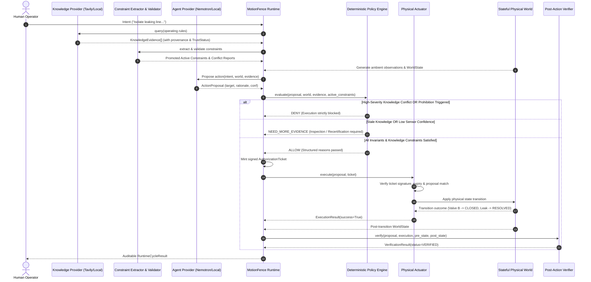

# MotionFence Architecture

## 1. System Overview

**MotionFence** is a deterministic runtime authorization layer for AI-generated physical actions.

In physical and industrial environments, deploying Large Language Models (LLMs) or autonomous reasoning agents introduces severe safety risks when models possess direct actuator authority. Models can hallucinate, suffer from perceptual ambiguity, misunderstand plant invariants, or act on ungrounded sensor data.

MotionFence establishes four non-negotiable architectural invariants:
1. **Invariant A — External knowledge is untrusted**: Retrieved documentation is evidence, not executable policy.
2. **Invariant B — Model output is untrusted**: The model may propose actions, rationales, and candidate rules, but cannot authorize actions, mint tickets, or mutate state.
3. **Invariant C — Deterministic policy remains authoritative**: Physical mutation is exclusively gated by `PolicyEngine -> AuthorizationTicket -> Actuator`.
4. **Invariant D — Verification remains independent**: Actuator execution is not proof of success; physical outcomes are independently verified against ground truth.

---

## 2. Core Control Loop

```text
External / Local Knowledge (Tavily / SOPs)
        │
        ▼
Knowledge Evidence (Provenance, TrustStatus, Freshness)
        │
        ▼
Candidate Constraint (Structured Pydantic Model)
        │
        ▼
Deterministic Validation (Schema, References, Freshness)
        │
        ▼
Active Policy Constraint (Promoted & Conflict-Checked)
        │
        ▼
Nemotron Action Proposal (Unprivileged)
        │
        ▼
Deterministic PolicyEngine (LLM-Free Gating)
        │
    ┌───┴───────────────┬──────────────────┐
    ▼                   ▼                  ▼
  ALLOW               DENY           NEED_MORE_EVIDENCE
    │
    ▼
AuthorizationTicket (HMAC-SHA256 Signed, Single-Use)
    │
    ▼
Physical Actuator Execution
    │
    ▼
Independent Post-Action Verification
```

### Control Loop Stages:
1. **Retrieve Knowledge & Formulate Constraints**: Query operational manuals via `KnowledgeProvider`, parse into typed `CandidateConstraint` objects, validate evidence provenance and freshness, and promote to active policy rules.
2. **Detect Conflicts**: Check for mutual contradictions across knowledge sources (e.g. prohibition vs permissive emergency rule). High-severity conflicts flag `CONFLICTED` state.
3. **Observe**: Ingest physical sensor readings (vision, pressure, thermal, safety zones) with explicit confidence scores and sensor provenance.
4. **Propose**: The agent system ([`NebiusNemotronProvider`](file:///Users/urjasoft/Documents/MotionFence/motionfence/agent/nebius_provider.py) or [`LocalDeterministicProvider`](file:///Users/urjasoft/Documents/MotionFence/motionfence/agent/provider.py)) formulates an unprivileged [`ActionProposal`](file:///Users/urjasoft/Documents/MotionFence/motionfence/models/actions.py).
5. **Evaluate Policy**: The deterministic [`PolicyEngine`](file:///Users/urjasoft/Documents/MotionFence/motionfence/policy/engine.py) (containing **zero LLM code**) evaluates proposal against hard invariants, sensor contradictions, and active knowledge constraints.
6. **Authorize / Deny / Request Evidence**:
   - `ALLOW`: Mints a cryptographically signed [`AuthorizationTicket`](file:///Users/urjasoft/Documents/MotionFence/motionfence/models/actions.py).
   - `DENY`: Rejects actuation with structured reasons.
   - `NEED_MORE_EVIDENCE`: Defers action and commands targeted multi-modal inspection or recertification of stale knowledge.
7. **Act**: The [`PhysicalActuator`](file:///Users/urjasoft/Documents/MotionFence/motionfence/simulation/actuator.py) strictly verifies the ticket signature, expiry, and proposal binding before commanding hardware or stateful simulation.
8. **Verify**: The [`PostActionVerifier`](file:///Users/urjasoft/Documents/MotionFence/motionfence/runtime/verification.py) compares ground-truth post-state against declared postconditions.

---

## 3. Package & Module Boundaries

```text
motionfence/
├── agent/            # Agent proposal protocols & provider implementations
│   ├── exceptions.py # ProviderError, NebiusProviderError, ModelProposalValidationError
│   ├── nebius_provider.py # Real Nebius Token Factory + NVIDIA Nemotron provider
│   ├── prompt.py     # System instructions and context builder
│   └── provider.py   # ActionProposalProvider, LocalDeterministicProvider
├── config/           # Pydantic Settings & threshold configuration
│   └── settings.py   # Settings, PolicySettings, NebiusSettings, TavilySettings
├── constraints/      # Candidate constraint models, extractor, validator, conflict
│   ├── models.py     # CandidateConstraint, ConstraintType, ConstraintStatus, ConflictReport
│   ├── extractor.py  # ConstraintExtractor protocol
│   ├── local_extractor.py # Deterministic local constraint extractor
│   ├── validator.py  # ConstraintValidator (schema, references, freshness promotion)
│   └── conflict.py   # ConstraintConflictDetector (mutual contradiction analysis)
├── evidence/         # Evidence representations & contradiction detection
│   ├── models.py     # Evidence, EvidenceSource, ContradictionReport
│   └── contradiction.py # ContradictionDetector (multi-sensor conflict analysis)
├── knowledge/        # Operational knowledge retrieval & trust model
│   ├── models.py     # KnowledgeEvidence, TrustStatus, FreshnessStatus
│   ├── provider.py   # KnowledgeProvider protocol & TavilyProviderError
│   ├── local_provider.py # LocalKnowledgeProvider (synthetic plant fixtures)
│   ├── tavily_provider.py # TavilyKnowledgeProvider (real Tavily API integration)
│   └── retrieval.py  # KnowledgeRetrievalService (provenance registry)
├── models/           # Core domain models
│   ├── actions.py    # ActionProposal, AuthorizationTicket, ExecutionResult
│   ├── events.py     # RuntimeEvent, EventType (with knowledge & constraint events)
│   └── world.py      # WorldState, ValveState, CoolingState, LeakState, PumpState
├── policy/           # Deterministic policy engine
│   ├── engine.py     # PolicyEngine.evaluate (NO LLM CALLS; active constraint evaluation)
│   └── models.py     # Policy, PolicyDecision, PolicyReason, DecisionType
├── runtime/          # Central orchestration & post-action verification
│   ├── core.py       # MotionFenceRuntime orchestrator
│   ├── events.py     # EventBus & audit telemetry
│   ├── ticket.py     # TicketAuthority (HMAC-SHA256 signature generator)
│   └── verification.py # PostActionVerifier & VerificationResult
└── simulation/       # Stateful physical environment simulator
    ├── actuator.py   # PhysicalActuator (ticket-gated execution)
    ├── demo.py       # Interactive terminal demonstration (multi-scenario)
    ├── exceptions.py # UnauthorizedActionError, ActuatorFaultError
    └── world.py      # PhysicalWorld state machine (valves, pumps, leaks, zones)
```

---

## 4. Sequence of Execution



---

## 5. Knowledge & Policy Constraint Architecture

### 5.1 Knowledge Retrieval
`KnowledgeProvider` represents the retrieval protocol:
- **`LocalKnowledgeProvider`**: Embedded deterministic synthetic plant safety manual fixtures (prohibitions, routine procedures, contradictions, stale sources, missing provenance).
- **`TavilyKnowledgeProvider`**: Real external Tavily Search API client. All retrieved documents are classified as `UNVERIFIED_EXTERNAL`. It enforces timeouts and catches authentication errors. When `TAVILY_API_KEY` is not present, it raises `TavilyProviderError` without silently fabricating data.

### 5.2 Structured Candidate Constraints
Extracted rules must be represented structurally in `CandidateConstraint` objects:
- `constraint_type`: `PROHIBITION`, `REQUIREMENT`, `PRECONDITION`, `POSTCONDITION`, `INFORMATIONAL`.
- `action`: Specific `ActionType` or `None`.
- `target`: Target physical entity (e.g. `valve_b`).
- `condition`: State predicate dictionary (e.g. `{"pump_p1": "ACTIVE"}`).
- `source_evidence_id`: Strict foreign-key reference to registered `KnowledgeEvidence`.
- `confidence`: Extraction confidence `[0.0, 1.0]`.

### 5.3 Deterministic Promotion Boundary
A candidate constraint never becomes active simply because an LLM generated it:
1. `ConstraintValidator.validate()` checks type schema, existence of target, condition validity, and provenance.
2. If `source_evidence_id` does not exist in the evidence registry, the constraint is rejected (`status=REJECTED`).
3. If source evidence is stale (`is_stale=True`), the constraint is marked `STALE` and cannot become `ACTIVE`.
4. If type is `INFORMATIONAL` (routine procedure), it remains informational and cannot become an active prohibition.
5. Only valid, non-stale, non-informational rules are promoted to `ACTIVE`.

### 5.4 Conflict Detection
`ConstraintConflictDetector` identifies mutually opposing rules (such as prohibition of valve closure vs permissive emergency guidelines) on the same target and action. Such pairs are flagged `CONFLICTED`. The `PolicyEngine` treats unresolved conflicts as hard safety blockers, generating a `DENY` verdict.

---

## 6. Integration Status & Roadmap

| Subsystem | Status | Verification State |
| :--- | :--- | :--- |
| **Deterministic Policy Engine** | `IMPLEMENTED` | `OFFLINE VERIFIED` (Policy tests) |
| **Evidence Contradiction** | `IMPLEMENTED` | `OFFLINE VERIFIED` (Multi-sensor tests) |
| **Simulator & Mechanical Verifier** | `IMPLEMENTED` | `OFFLINE VERIFIED` (Simulator tests) |
| **Authority Isolation & HMAC Tickets** | `IMPLEMENTED` | `OFFLINE VERIFIED` (7 security tests) |
| **Local Knowledge Fixtures** | `IMPLEMENTED` | `OFFLINE VERIFIED` (Synthetic manual) |
| **Constraint Extractor & Validator** | `IMPLEMENTED` | `OFFLINE VERIFIED` (Extractor tests) |
| **Conflict & Freshness Engines** | `IMPLEMENTED` | `OFFLINE VERIFIED` (Conflict tests) |
| **Nebius / NVIDIA Nemotron Provider** | `IMPLEMENTED` | `LIVE VERIFICATION PENDING CREDENTIALS` |
| **Tavily Knowledge Provider** | `IMPLEMENTED` | `LIVE VERIFICATION PENDING CREDENTIALS` |
| **Physical Hardware Adapter (ROS 2/GPIO)** | `PLANNED` | Phase 3 |
| **Observability Telemetry Dashboard** | `PLANNED` | Phase 2B |
