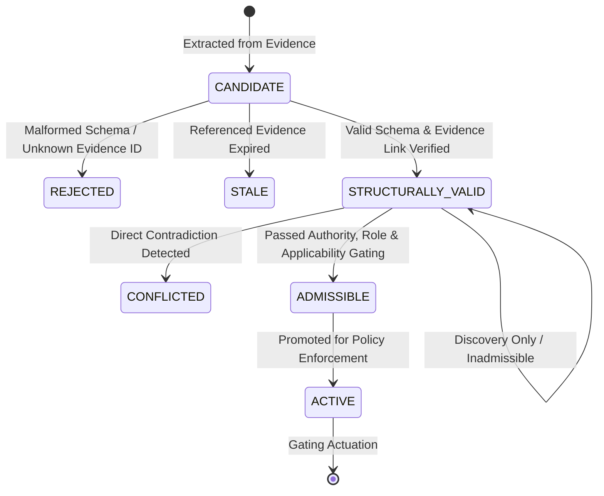

# MotionFence Architecture

## 1. System Overview

**MotionFence** is a deterministic runtime authorization layer for AI-generated physical actions.

In physical and industrial environments, deploying Large Language Models (LLMs) or autonomous reasoning agents introduces severe safety risks when models possess direct actuator authority. Models can hallucinate, suffer from perceptual ambiguity, misunderstand plant invariants, or act on ungrounded sensor data.

MotionFence establishes core non-negotiable architectural invariants:
1. **Invariant A — External knowledge is untrusted**: Retrieved documentation is evidence, not executable policy.
2. **Invariant B — Model output is untrusted**: The model may propose actions, rationales, and candidate rules, but cannot authorize actions, mint tickets, or mutate state.
3. **Invariant C — Deterministic policy remains authoritative**: Physical mutation is exclusively gated by `PolicyEngine -> AuthorizationTicket -> Actuator`.
4. **Invariant D — Verification remains independent**: Actuator execution is not proof of success; physical outcomes are independently verified against ground truth.
5. **Phase 2C Core Principle**:
   ```text
   SOURCE EXISTS ≠ SOURCE IS TRUSTWORTHY ≠ CLAIM IS PRESENT IN SOURCE ≠ CLAIM IS DIRECTLY SUPPORTED ≠ CLAIM IS APPLICABLE ≠ CLAIM IS SUFFICIENT FOR AUTHORIZATION
   ```
   - **Tavily provides discovery and external evidence. It does not provide authority.**
   - **Nemotron interprets evidence and extracts claims. It does not provide authority.**
   - **Claim Grounding verifies that claims are directly or verbatim supported in source text.**
   - **The deterministic MotionFence runtime decides whether evidence is admissible and whether an action is authorized.**

---

## 2. Core Control Loop

```text
Knowledge Evidence (Tavily / Local Manuals)
      ↓
Source Assessment (Origin Category & Authority)
      ↓
Nemotron Claim Extraction (CandidateConstraint)
      ↓
Claim Grounding (LocalDeterministicClaimGrounder → ClaimSupportCertificate)
      ↓
Admissibility Gate (Source Trust, Corroboration, Plant Applicability)
      ↓
Deterministic Validation (Schema, References, Freshness)
      ↓
ACTIVE POLICY CONSTRAINT (or Retained Inadmissible)
      ↓
Nemotron Action Proposal (Unprivileged)
      ↓
Deterministic PolicyEngine (LLM-Free Gating)
      │
  ┌───┴───────────────┬──────────────────┐
  ▼                   ▼                  ▼
ALLOW               DENY           NEED_MORE_EVIDENCE
  │
  ▼
AuthorizationTicket (HMAC-SHA256 Signed, Single-Use)
  │
  ▼
Physical Actuator Execution
  │
  ▼
Independent Post-Action Verification
```

### Control Loop Stages:
1. **Retrieve Knowledge**: Query operational sources via `KnowledgeRetrievalService` (using `TavilyKnowledgeProvider` or `LocalKnowledgeProvider`).
2. **Source Assessment & Role Classification**: `SourceTrustClassifier` categorizes source origin (`FIRST_PARTY_OFFICIAL`, `MANUFACTURER_DOCUMENTATION`, etc.) and assigns explicit roles (`DISCOVERY`, `SUPPORTING`, `AUTHORIZATION_RELEVANT`, `REJECTED`).
3. **Corroboration Evaluation**: `CorroborationEngine` determines whether operational claims are corroborated by independent qualified sources or represent scraped mirror text duplicates.
4. **Constraint Extraction**: Extract operational rules using `NemotronConstraintExtractor` or `LocalConstraintExtractor` into typed `CandidateConstraint` objects.
5. **Empirical Claim Grounding (Phase 2C)**: `LocalDeterministicClaimGrounder` issues an auditable `ClaimSupportCertificate`. Evaluates direct support, detects paraphrases vs ungrounded causal inferences, preserves operating conditions, and blocks inverted negations or broadened equipment scopes.
6. **Admissibility & Applicability Gating**: `ConstraintValidator.check_admissibility` verifies claim grounding (`SUPPORTED`), source authority, and `PlantContext` alignment.
7. **Deterministic Promotion**: Only grounded, admissible, non-stale constraints are promoted to `ACTIVE`.
8. **Observe & Propose**: Record physical observations and generate unprivileged `ActionProposal` via Nemotron or local provider.
9. **Evaluate Policy**: The deterministic `PolicyEngine` evaluates proposal against hard invariants, sensor contradictions, and active knowledge constraints.
10. **Authorize / Deny / Request Evidence**:
   - `ALLOW`: Mints a cryptographically signed `AuthorizationTicket`.
   - `DENY`: Rejects actuation with structured reasons.
   - `NEED_MORE_EVIDENCE`: Defers action and commands targeted multi-modal inspection or recertification of stale knowledge.
11. **Act & Verify**: `PhysicalActuator` checks ticket HMAC and commands actuation; `PostActionVerifier` independently confirms physical post-state.


---

## 3. Package & Module Boundaries

```text
motionfence/
├── agent/            # Agent proposal protocols & provider implementations
│   ├── exceptions.py # ProviderError, NebiusProviderError, ModelProposalValidationError
│   ├── nebius_provider.py # Real Nebius Token Factory + NVIDIA Nemotron provider
│   ├── prompt.py     # System instructions and context builder
│   └── provider.py   # ActionProposalProvider, LocalDeterministicProvider
├── config/           # Pydantic Settings & threshold configuration
│   └── settings.py   # Settings, PolicySettings, NebiusSettings, TavilySettings
├── constraints/      # Candidate constraint models, extractor, validator, conflict, grounding
│   ├── models.py     # CandidateConstraint, ConstraintType, ConstraintStatus, PlantContext, Applicability
│   ├── grounding.py  # ClaimSupportCertificate, SupportType, SupportStatus, LocalDeterministicClaimGrounder
│   ├── extractor.py  # ConstraintExtractor protocol
│   ├── local_extractor.py # Deterministic local constraint extractor
│   ├── nemotron_extractor.py # NemotronConstraintExtractor (Nebius Token Factory)
│   ├── validator.py  # ConstraintValidator (structural, admissibility, applicability, grounding)
│   └── conflict.py   # ConstraintConflictDetector (source, policy, applicability, freshness)
├── evidence/         # Evidence representations & contradiction detection
│   ├── models.py     # Evidence, EvidenceSource, ContradictionReport
│   └── contradiction.py # ContradictionDetector (multi-sensor conflict analysis)
├── knowledge/        # Operational knowledge retrieval, trust, & corroboration
│   ├── models.py     # KnowledgeEvidence, TrustStatus, FreshnessStatus
│   ├── trust.py      # SourceCategory, AuthorityLevel, EvidenceRole, SourceTrustClassifier, CorroborationEngine
│   ├── provider.py   # KnowledgeProvider protocol & TavilyProviderError
│   ├── local_provider.py # LocalKnowledgeProvider (synthetic plant fixtures)
│   ├── tavily_provider.py # TavilyKnowledgeProvider (real Tavily API integration)
│   └── retrieval.py  # KnowledgeRetrievalService (provenance registry)
├── models/           # Core domain models
│   ├── actions.py    # ActionProposal, AuthorizationTicket, ExecutionResult
│   ├── events.py     # RuntimeEvent, EventType (Phase 2B audit events)
│   └── world.py      # WorldState, ValveState, CoolingState, LeakState, PumpState
├── policy/           # Deterministic policy engine
│   ├── engine.py     # PolicyEngine.evaluate (NO LLM CALLS; active constraint evaluation)
│   └── models.py     # Policy, PolicyDecision, PolicyReason, DecisionType
├── runtime/          # Central orchestration & post-action verification
│   ├── core.py       # MotionFenceRuntime orchestrator
│   ├── events.py     # EventBus & audit telemetry
│   ├── ticket.py     # TicketAuthority (HMAC-SHA256 signature generator)
│   └── verification.py # PostActionVerifier & VerificationResult
└── simulation/       # Stateful physical environment simulator
    ├── actuator.py   # PhysicalActuator (ticket-gated execution)
    ├── demo.py       # Interactive terminal demonstration (multi-scenario)
    ├── exceptions.py # UnauthorizedActionError, ActuatorFaultError
    └── world.py      # PhysicalWorld state machine (valves, pumps, leaks, zones)
```

---

## 4. Constraint Qualification Lifecycle



---

## 5. Integration Status & Test Summary

| Subsystem | Status | Verification State |
| :--- | :--- | :--- |
| **Deterministic Policy Engine** | `IMPLEMENTED` | `OFFLINE VERIFIED` (Policy tests) |
| **Evidence Contradiction** | `IMPLEMENTED` | `OFFLINE VERIFIED` (Multi-sensor tests) |
| **Simulator & Mechanical Verifier** | `IMPLEMENTED` | `OFFLINE VERIFIED` (Simulator tests) |
| **Authority Isolation & HMAC Tickets** | `IMPLEMENTED` | `OFFLINE VERIFIED` (7 security tests) |
| **Local Knowledge Fixtures** | `IMPLEMENTED` | `OFFLINE VERIFIED` (Synthetic manual) |
| **Source Trust & Evidence Roles** | `IMPLEMENTED` | `OFFLINE VERIFIED` (Trust classification tests) |
| **Admissibility & Applicability** | `IMPLEMENTED` | `OFFLINE VERIFIED` (Admissibility tests) |
| **Corroboration & Deduplication** | `IMPLEMENTED` | `OFFLINE VERIFIED` (Corroboration tests) |
| **Constraint Extractor & Validator** | `IMPLEMENTED` | `OFFLINE VERIFIED` (Validator tests) |
| **Nemotron Constraint Extractor** | `IMPLEMENTED` | `OFFLINE VERIFIED` (Transport mock tests) |
| **Conflict & Freshness Engines** | `IMPLEMENTED` | `OFFLINE VERIFIED` (Conflict tests) |
| **Nebius / NVIDIA Nemotron Provider** | `IMPLEMENTED` | `LIVE VERIFICATION PENDING CREDENTIALS` |
| **Tavily Knowledge Provider** | `IMPLEMENTED` | `LIVE VERIFIED` (Real Tavily search verified) |
| **Physical Hardware Adapter (ROS 2/GPIO)** | `PLANNED` | Phase 3 |

