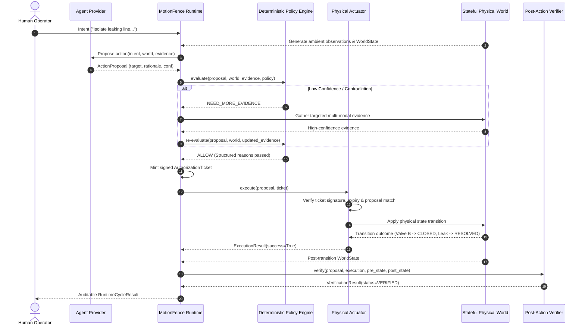

# MotionFence Architecture

## 1. System Overview

**MotionFence** is a deterministic runtime authorization layer for AI-generated physical actions.

In physical and industrial environments, deploying Large Language Models (LLMs) or autonomous reasoning agents introduces severe safety risks when models possess direct actuator authority. Models can hallucinate, suffer from perceptual ambiguity, misunderstand plant invariants, or act on ungrounded sensor data.

MotionFence establishes an architectural invariant:
> **An LLM must never have direct authority over an actuator.**
> The AI agent proposes what should happen; a deterministic MotionFence runtime independently decides whether the physical action is allowed, requires additional evidence, or must be denied.

---

## 2. Core Control Loop

```text
                 Human Intent
                      │
                      ▼
              Agent / Proposal
                      │
                      ▼
              Evidence Model
                      │
                      ▼
             Policy Evaluation
                      │
          ┌───────────┼───────────┐
          ▼           ▼           ▼
        DENY     NEED_EVIDENCE   ALLOW
                                      │
                                      ▼
                               Action Runtime
                                      │
                                      ▼
                              World / Actuator
                                      │
                                      ▼
                               Verification
                                      │
                                      ▼
                              Verified Outcome
```

The system executes a strictly ordered 6-phase cycle:

1. **Observe**: Ingest physical sensor readings (vision, pressure, thermal, acoustic, zone monitors) with explicit confidence scores and provenance.
2. **Propose**: The agent interprets intent and observations, formulating an [`ActionProposal`](file:///Users/urjasoft/Documents/MotionFence/motionfence/models/actions.py) with rationale and supporting evidence.
3. **Evaluate Policy**: The deterministic [`PolicyEngine`](file:///Users/urjasoft/Documents/MotionFence/motionfence/policy/engine.py) (containing **zero LLM code**) evaluates the proposal against declarative safety invariants, contradiction reports, and confidence bounds.
4. **Authorize / Deny / Request Evidence**:
   - `ALLOW`: Mints a cryptographically signed [`AuthorizationTicket`](file:///Users/urjasoft/Documents/MotionFence/motionfence/models/actions.py).
   - `DENY`: Rejects actuation with structured reasons.
   - `NEED_MORE_EVIDENCE`: Defers action and commands targeted multi-modal inspection.
5. **Act**: The [`PhysicalActuator`](file:///Users/urjasoft/Documents/MotionFence/motionfence/simulation/actuator.py) verifies the ticket signature and invariants before commanding hardware or stateful simulation.
6. **Verify**: The [`PostActionVerifier`](file:///Users/urjasoft/Documents/MotionFence/motionfence/runtime/verification.py) compares ground-truth post-state against declared postconditions, distinguishing commanded action from verified physical outcome.

---

## 3. Package & Module Boundaries

The repository is modularized into distinct, decoupled packages:

```text
motionfence/
├── agent/            # Agent proposal protocols & provider implementations
│   ├── exceptions.py # ProviderError, NebiusProviderError, ModelProposalValidationError
│   ├── nebius_provider.py # Real Nebius Token Factory + NVIDIA Nemotron provider
│   ├── prompt.py     # System instructions and context builder
│   └── provider.py   # ActionProposalProvider, LocalDeterministicProvider
├── config/           # Pydantic Settings & threshold configuration
│   └── settings.py   # Settings, PolicySettings, NebiusSettings
├── evidence/         # Evidence representations & contradiction detection
│   ├── models.py     # Evidence, EvidenceSource, ContradictionReport
│   └── contradiction.py # ContradictionDetector (multi-sensor conflict analysis)
├── models/           # Core domain models
│   ├── actions.py    # ActionProposal, AuthorizationTicket, ExecutionResult
│   ├── events.py     # RuntimeEvent, EventType (with model observability events)
│   └── world.py      # WorldState, ValveState, CoolingState, LeakState
├── policy/           # Deterministic policy engine
│   ├── engine.py     # PolicyEngine.evaluate (NO LLM CALLS)
│   └── models.py     # Policy, PolicyDecision, PolicyReason, DecisionType
├── runtime/          # Central orchestration & post-action verification
│   ├── core.py       # MotionFenceRuntime orchestrator
│   ├── events.py     # EventBus & audit telemetry
│   ├── ticket.py     # TicketAuthority (HMAC-SHA256 signature generator)
│   └── verification.py # PostActionVerifier & VerificationResult
└── simulation/       # Stateful physical environment simulator
    ├── actuator.py   # PhysicalActuator (ticket-gated execution)
    ├── demo.py       # Interactive terminal demonstration (multi-scenario)
    ├── exceptions.py # UnauthorizedActionError, ActuatorFaultError
    └── world.py      # PhysicalWorld state machine
```

---

## 4. Sequence of Execution



---

## 5. Nebius Token Factory + NVIDIA Nemotron Integration

### 5.1 Architecture & Role
The [`NebiusNemotronProvider`](file:///Users/urjasoft/Documents/MotionFence/motionfence/agent/nebius_provider.py) implements the [`ActionProposalProvider`](file:///Users/urjasoft/Documents/MotionFence/motionfence/agent/provider.py) protocol via the OpenAI-compatible endpoint of Nebius Token Factory (`https://api.tokenfactory.nebius.com/v1/`).

Configured model:
```text
nvidia/nemotron-3-super-120b-a12b
```

### 5.2 Strict Proposal Role (No Execution Authority)
Nemotron is treated as an untrusted, unprivileged reasoning module:
- It receives human intent, observed environment, and ground-truth sensor evidence.
- It is instructed via system prompt that it possesses **zero physical authority**.
- It does **not** receive actuator handles, ticket-signing secrets, or permission tokens.
- Its output is converted into an [`ActionProposal`](file:///Users/urjasoft/Documents/MotionFence/motionfence/models/actions.py) and handed to the [`PolicyEngine`](file:///Users/urjasoft/Documents/MotionFence/motionfence/policy/engine.py).

### 5.3 Structured Output & Evidence Discipline
Model responses are parsed and validated against strict domain constraints:
1. Valid JSON payload matching `action`, `target`, `confidence`, `rationale`, and `evidence_refs`.
2. Action must belong to [`ActionType`](file:///Users/urjasoft/Documents/MotionFence/motionfence/models/actions.py).
3. Confidence must fall within `[0.0, 1.0]`.
4. **Evidence Discipline**: Every evidence ID cited in `evidence_refs` must exist in the context provided by the runtime. If the model hallucinates or cites an unknown evidence ID, the proposal is immediately rejected with [`ModelProposalValidationError`](file:///Users/urjasoft/Documents/MotionFence/motionfence/agent/exceptions.py).

### 5.4 Bounded Retries & Safe Timeouts
The provider differentiates between:
* **Retryable errors**: Transient network blips, HTTP 429 rate limits, HTTP 500/502/503 server errors, and timeouts (uses bounded exponential backoff with jitter up to `NEBIUS_MAX_RETRIES`).
* **Non-retryable errors**: HTTP 401 authentication errors, HTTP 400 bad requests, and schema validation failures.
* **Failure Safety**: If inference fails or times out, the runtime returns an error cycle with **zero world mutation**, zero ticket minting, and zero physical actuation.

### 5.5 Offline Testing Strategy & Live Smoke Test
* **Offline Tests**: All unit and integration tests mock provider responses using dependency injection, allowing `pytest` to run completely offline without `NEBIUS_API_KEY`.
* **Live Smoke Test**: [`scripts/smoke_nebius.py`](file:///Users/urjasoft/Documents/MotionFence/scripts/smoke_nebius.py) connects to the live Nebius Token Factory endpoint when `NEBIUS_API_KEY` is provided in the environment.

---

## 6. Integration Status & Roadmap

| Subsystem | Status | Details |
| :--- | :--- | :--- |
| **Policy Engine** | `IMPLEMENTED` | Deterministic, zero LLM calls, structured reasons |
| **Evidence Contradiction** | `IMPLEMENTED` | Cross-sensor conflict scoring (vision vs pressure) |
| **Simulator** | `IMPLEMENTED` | Stateful miniature plant with leak and fault dynamics |
| **Authority Isolation** | `IMPLEMENTED` | Ticket-gated HMAC-SHA256 execution verification |
| **Post-Action Verifier** | `IMPLEMENTED` | Ground-truth state comparison vs expected postconditions |
| **Nebius / Nemotron** | `IMPLEMENTED` | Real Token Factory API integration with strict validation |
| **Tavily Knowledge** | `PLANNED` | Retrieval of live plant SOPs and operating manuals |
| **Physical Hardware** | `PLANNED` | ROS 2 / Modbus / GPIO hardware adapter layer |
