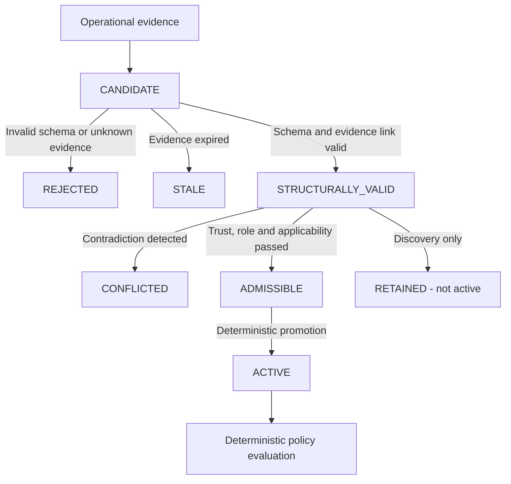

# MotionFence Architecture

## 1. System Overview

**MotionFence** is a deterministic runtime authorization layer for AI-generated physical actions.

In physical and industrial environments, deploying Large Language Models (LLMs) or autonomous reasoning agents introduces severe safety risks when models possess direct actuator authority. Models can hallucinate, suffer from perceptual ambiguity, misunderstand plant invariants, or act on ungrounded sensor data.

MotionFence establishes core non-negotiable architectural invariants:
1. **Invariant A — External knowledge is untrusted**: Retrieved documentation is evidence, not executable policy.
2. **Invariant B — Model output is untrusted**: The model may propose actions, rationales, and candidate rules, but cannot authorize actions, mint tickets, or mutate state.
3. **Invariant C — Deterministic policy remains authoritative**: Physical mutation is exclusively gated by `PolicyEngine -> AuthorizationTicket -> Actuator`.
4. **Invariant D — Verification remains independent**: Actuator execution is not proof of success; physical outcomes are independently verified against ground truth.
5. **Phase 2C Core Principle**:
   ```text
   SOURCE EXISTS ≠ SOURCE IS TRUSTWORTHY ≠ CLAIM IS PRESENT IN SOURCE ≠ CLAIM IS DIRECTLY SUPPORTED ≠ CLAIM IS APPLICABLE ≠ CLAIM IS SUFFICIENT FOR AUTHORIZATION
   ```
   - **Tavily provides discovery and external evidence. It does not provide authority.**
   - **Nemotron interprets evidence and extracts claims. It does not provide authority.**
   - **Claim Grounding verifies that claims are directly or verbatim supported in source text.**
   - **The deterministic MotionFence runtime decides whether evidence is admissible and whether an action is authorized.**

---

## 2. Core Control Loop

```text
Knowledge Evidence (Tavily / Local Manuals)
      ↓
Source Assessment (Origin Category & Authority)
      ↓
Nemotron Claim Extraction (CandidateConstraint)
      ↓
Claim Grounding (LocalDeterministicClaimGrounder → ClaimSupportCertificate)
      ↓
Admissibility Gate (Source Trust, Corroboration, Plant Applicability)
      ↓
Deterministic Validation (Schema, References, Freshness)
      ↓
ACTIVE POLICY CONSTRAINT (or Retained Inadmissible)
      ↓
Nemotron Action Proposal (Unprivileged)
      ↓
Deterministic PolicyEngine (LLM-Free Gating)
      │
  ┌───┴───────────────┬──────────────────┐
  ▼                   ▼                  ▼
ALLOW               DENY           NEED_MORE_EVIDENCE
  │
  ▼
SAFETY ENCLAVE Authorization (Encapsulated TicketAuthority)
  │
  ▼
AuthorizationTicket (HMAC-SHA256 Signed, Single-Use)
  │
  ▼
Physical Actuator Execution
  │
  ▼
Independent Post-Action Verification
  │
  ▼
DecisionRecord Finalized & Hash-Linked (SHA-256 Audit Chain)
```

### Control Loop Stages:
1. **Retrieve Knowledge**: Query operational sources via `KnowledgeRetrievalService` (using `TavilyKnowledgeProvider` or `LocalKnowledgeProvider`).
2. **Source Assessment & Role Classification**: `SourceTrustClassifier` categorizes source origin (`FIRST_PARTY_OFFICIAL`, `MANUFACTURER_DOCUMENTATION`, etc.) and assigns explicit roles (`DISCOVERY`, `SUPPORTING`, `AUTHORIZATION_RELEVANT`, `REJECTED`).
3. **Corroboration Evaluation**: `CorroborationEngine` determines whether operational claims are corroborated by independent qualified sources or represent scraped mirror text duplicates.
4. **Constraint Extraction**: Extract operational rules using `NemotronConstraintExtractor` or `LocalConstraintExtractor` into typed `CandidateConstraint` objects.
5. **Empirical Claim Grounding (Phase 2C)**: `LocalDeterministicClaimGrounder` issues an auditable `ClaimSupportCertificate`. Evaluates direct support, detects paraphrases vs ungrounded causal inferences, preserves operating conditions, and blocks inverted negations or broadened equipment scopes.
6. **Admissibility & Applicability Gating**: `ConstraintValidator.check_admissibility` verifies claim grounding (`SUPPORTED`), source authority, and `PlantContext` alignment.
7. **Deterministic Promotion**: Only grounded, admissible, non-stale constraints are promoted to `ACTIVE`.
8. **Observe & Propose**: Record physical observations and generate unprivileged `ActionProposal` via Nemotron or local provider.
9. **Evaluate Policy**: The deterministic `PolicyEngine` evaluates proposal against hard invariants, sensor contradictions, and active knowledge constraints.
10. **Safety Enclave Authorization (Phase 2D)**:
   - The proposal, policy decision, and world snapshot enter `SafetyEnclave`.
   - `SafetyEnclave` verifies preconditions deterministically.
   - If `ALLOW`: Mints a cryptographically signed, single-use `AuthorizationTicket` via encapsulated `TicketAuthority`.
   - If `DENY`: Rejects actuation with structured reasons.
   - If `NEED_MORE_EVIDENCE`: Defers action and commands targeted multi-modal inspection or recertification of stale knowledge.
11. **Act & Verify**: `PhysicalActuator` checks ticket HMAC and commands actuation; `PostActionVerifier` independently confirms physical post-state.
12. **Audit Finalization (Phase 2D)**:
   - `DecisionRecorder` serializes complete cycle provenance into immutable `DecisionRecord`.
   - Computes canonical SHA-256 hash linked to previous record hash.

---

## 3. Package & Module Boundaries

```text
motionfence/
├── agent/            # Agent proposal protocols & provider implementations
│   ├── exceptions.py # ProviderError, NebiusProviderError, ModelProposalValidationError
│   ├── nebius_provider.py # Real Nebius Token Factory + NVIDIA Nemotron provider
│   ├── prompt.py     # System instructions and context builder
│   └── provider.py   # ActionProposalProvider, LocalDeterministicProvider
├── assurance/        # Phase 2E: Bounded assurance & adversarial evaluation engine
│   ├── models.py     # FormalState, AssuranceFinding, AssuranceReport, AdversarialCaseResult
│   ├── invariants.py # AssuranceProperty and AssurancePropertyRegistry
│   ├── checker.py    # BoundedAssuranceChecker (isolated Z3 SMT solver)
│   ├── temporal.py   # BoundedTemporalChecker (bounded multi-step horizon analysis)
│   ├── counterexample.py # CounterexampleFormatter and root-cause minimizer
│   ├── adversarial.py # Combinatorial and boundary test case generator
│   ├── evaluator.py  # Property-based fuzzing orchestrator and test shrinker
│   └── reporting.py  # Structured JSON assurance report persistence
├── audit/            # Phase 2D: Decision records, hash-linked chain, replay, verifier
│   ├── models.py     # DecisionRecord, DecisionCategory, ExecutionMode, SourceMode, audit formatters
│   ├── serialization.py # Canonical JSON serialization and deterministic SHA-256 hashing
│   ├── recorder.py   # DecisionRecorder (append-only hash-linked audit chain)
│   ├── verifier.py   # DecisionRecordVerifier (cryptographic integrity & snapshot validation)
│   └── replay.py     # DecisionReplayEngine (10-step offline deterministic reconstruction)
├── config/           # Pydantic Settings & threshold configuration
│   └── settings.py   # Settings, PolicySettings, NebiusSettings, TavilySettings
├── constraints/      # Candidate constraint models, extractor, validator, conflict, grounding
│   ├── models.py     # CandidateConstraint, ConstraintType, ConstraintStatus, PlantContext, Applicability
│   ├── grounding.py  # ClaimSupportCertificate, SupportType, SupportStatus, LocalDeterministicClaimGrounder
│   ├── extractor.py  # ConstraintExtractor protocol
│   ├── local_extractor.py # Deterministic local constraint extractor
│   ├── nemotron_extractor.py # NemotronConstraintExtractor (Nebius Token Factory)
│   ├── validator.py  # ConstraintValidator (structural, admissibility, applicability, grounding)
│   └── conflict.py   # ConstraintConflictDetector (source, policy, applicability, freshness)
├── evidence/         # Evidence representations & contradiction detection
│   ├── models.py     # Evidence, EvidenceSource, ContradictionReport
│   └── contradiction.py # ContradictionDetector (multi-sensor conflict analysis)
├── knowledge/        # Operational knowledge retrieval, trust, & corroboration
│   ├── models.py     # KnowledgeEvidence, TrustStatus, FreshnessStatus
│   ├── trust.py      # SourceCategory, AuthorityLevel, EvidenceRole, SourceTrustClassifier, CorroborationEngine
│   ├── provider.py   # KnowledgeProvider protocol & TavilyProviderError
│   ├── local_provider.py # LocalKnowledgeProvider (synthetic plant fixtures)
│   ├── tavily_provider.py # TavilyKnowledgeProvider (real Tavily API integration)
│   └── retrieval.py  # KnowledgeRetrievalService (provenance registry)
├── models/           # Core domain models
│   ├── actions.py    # ActionProposal, AuthorizationTicket, ExecutionResult
│   ├── events.py     # RuntimeEvent, EventType (Phase 2D audit and replay events)
│   └── world.py      # WorldState, ValveState, CoolingState, LeakState, PumpState
├── policy/           # Deterministic policy engine
│   ├── engine.py     # PolicyEngine.evaluate (NO LLM CALLS; active constraint evaluation)
│   └── models.py     # Policy, PolicyDecision, PolicyReason, DecisionType
├── runtime/          # Central orchestration & post-action verification
│   ├── core.py       # MotionFenceRuntime orchestrator
│   ├── enclave.py    # SafetyEnclave (Phase 2D isolated authorization boundary)
│   ├── events.py     # EventBus & audit telemetry
│   ├── ticket.py     # TicketAuthority (HMAC-SHA256 signature generator)
│   └── verification.py # PostActionVerifier & VerificationResult
└── simulation/       # Stateful physical environment simulator
    ├── actuator.py   # PhysicalActuator (ticket-gated execution)
    ├── demo.py       # Interactive terminal demonstration (multi-scenario)
    ├── exceptions.py # UnauthorizedActionError, ActuatorFaultError
    └── world.py      # PhysicalWorld state machine (valves, pumps, leaks, zones)
```

---

## 4. Constraint Qualification Lifecycle



---

## 5. Decision Records, Deterministic Replay & Safety Enclave (Phase 2D)

Phase 2D ensures that every physical authorization decision is explainable, replayable, tamper-evident, and independently checkable without re-calling models or external APIs.

### 5.1 Safety Enclave
```text
Untrusted World + Untrusted Model + Untrusted Knowledge
                      ↓
              MotionFence Core
                      ↓
               SAFETY ENCLAVE
                      ↓
            Authorization Decision
                      ↓
               Ticket Authority
```
- **Boundary rule**: Encapsulates `TicketAuthority`. **Only** the Safety Enclave may mint `AuthorizationTicket`.
- **Zero AI rule**: Contains zero LLM calls, zero Tavily/web retrieval, and zero natural language parsing. Evaluates structured, validated inputs only.

### 5.2 DecisionRecord Schema & Hash-Linked Audit Chain
- **DecisionRecord**: Captures intent, world state snapshot, sensor evidence IDs, knowledge evidence IDs, certificates, constraints, proposal, policy decision, ticket ID, execution result, verification result, runtime version, and policy version.
- **Canonical Serialization**: Deterministic serialization sorts dictionary keys, strips non-essential whitespace, rounds floating point numbers to 6 decimal places, and encodes as UTF-8 bytes.
- **Tamper-Evident Chain**: `record_hash = SHA-256(canonical_bytes + previous_record_hash)`. Any alteration of historical records invalidates the chain.

### 5.3 Deterministic Replay Engine
- Reconstructs all 10 decision lifecycle steps offline:
  ```text
  Intent → Evidence → Constraints → Policy → Decision → Ticket state → Execution state → Verification state
  ```
- **Replay Invariant**: Replay possesses zero actuator handles, mints zero tickets, and cannot mutate `WorldState`.
- Compares replayed deterministic evaluation with recorded verdict (`REPLAY_MATCH` vs `REPLAY_DIVERGENCE`).

---

## 6. Bounded Assurance & Adversarial Evaluation (Phase 2E)

Phase 2E provides machine-checkable assurance evidence and automated adversarial falsification.

### 6.1 SMT Invariant Verification (Z3 Solver)
```text
           Assurance Property Registry (PROP_001 .. PROP_007)
                                 │
                                 ▼
                     BoundedAssuranceChecker (Z3)
                                 │
                 ┌───────────────┴───────────────┐
                 ▼                               ▼
               UNSAT                            SAT
                 │                               │
                 ▼                               ▼
       Finding: SATISFIED              Finding: VIOLATED
  (No model violates property)     (Extract Minimized Counterexample)
```
* **Strict Boundary Rule**: Z3 SMT solver is isolated strictly to offline analysis. It never evaluates real-time runtime authorization.
* **Scope Definition**: `BOUNDED PROPERTY SATISFIED ≠ REAL-WORLD SAFETY PROVEN`. Checks evaluate bounded symbolic state variables and deterministic rules.

### 6.2 Bounded Temporal Checker
* Simulates discrete multi-step transitions over configurable horizons ($H = 1..5$).
* Evaluates bounded temporal properties:

  ```math
  G_{\mathrm{bounded}}(\mathrm{authorized\_close}(\mathrm{valve\_b}) \Rightarrow \mathrm{cooling} = \mathrm{ACTIVE})
  ```

* Confirms dynamic human incursions mid-sequence immediately block subsequent commands.

### 6.3 Property-Based Adversarial Falsification
* Fuzzes exact confidence boundaries (`0.89`, `0.899`, `0.90`, `0.901`).
* Evaluates multi-sensor discordant combinations to verify contradiction detection.
* Tests distorted operational claims (condition dropping, modal negation reversal, equipment broadening, fabricated thresholds).
* Evaluates source-trust attacks (Reddit forum posts, duplicate mirror scrapers, foreign pump models, stale bulletins).
* Prioritizes discovering critical `FALSE_ALLOW` hazards over false rejections.

---

## 7. State-Bound Authorization & TOCTOU Defense (Phase 2F)

Phase 2F introduces execution-time revalidation to detect and block modeled Time-of-Check vs Time-of-Use (**TOCTOU**) authorization-context drift.

```text
               Observation + Knowledge Retrieval
                               ↓
                   Deterministic Policy Evaluation
                               ↓
                        [ALLOW VERDICT]
                               ↓
                       SAFETY ENCLAVE
       (Binds State Version, State Hash, Policy Version,
        Constraint Set Hash, Evidence Context Hash, Nonce)
                               ↓
                 State-Bound AuthorizationTicket
                               ↓
            ═══════════════════════════════════════════
            EXECUTION-TIME REVALIDATION GATE (Phase 2F)
            - Re-checks current physical world state
            - Checks policy version & active constraints
            - Checks evidence context consistency
            - Verified in <1ms without models or network
            ═══════════════════════════════════════════
                   │                           │
              [MATCH / VALID]           [DRIFT DETECTED]
                   │                           │
                   ▼                           ▼
          Physical Actuator            ABORT ACTUATION
              Executes            (Ticket Invalidated, State Intact)
```

### 7.1 Security Invariants of Execution-Time Revalidation
1. **Locally Decidable Gate**: Zero model calls (no Nemotron), zero network calls (no Tavily). Purely deterministic and in-memory.
2. **Context-Bound Scope**: `AuthorizationTicket` is valid only for the exact world state version and hash at which it was minted.
3. **No Automatic Reauthorization**: A stale ticket is rejected immediately. It cannot be refreshed or revived by an LLM.
4. **Deterministic Replay Convergence**: Offline replay reconstructs issuance vs execution divergence and flags `TICKET_REVALIDATION_FAILED` without actuator access.

---

## 8. Active Evidence Acquisition & Safe Recovery (Phase 2G)

Phase 2G extends the MotionFence control loop to enable autonomous evidence gathering when encountering policy uncertainty (`NEED_MORE_EVIDENCE`), without granting the model or information gateway any consequential actuator authority.

```text
              Action Proposal (Unprivileged)
                           ↓
                PolicyEngine Evaluation
                           ↓
                  [NEED_MORE_EVIDENCE]
                           ↓
          ══════════════════════════════════════════════
          EVIDENCE ACQUISITION PLANNER
          - Nemotron / Local Deterministic Planner
          - Proposes typed InformationAction (e.g. INSPECT_TARGET, RESAMPLE_SENSOR)
          - Predicts information gain (LOW, MEDIUM, HIGH)
          - STRICT NON-ESCALATION: Consequential actions (CLOSE_VALVE) rejected
          ══════════════════════════════════════════════
                           ↓
          ══════════════════════════════════════════════
          EVIDENCE ACTION GATEWAY
          - CapabilityPolicy Gating:
            Allowed: [OBSERVE, INSPECT, READ_SENSOR, QUERY_KNOWLEDGE, REORIENT_SENSOR]
            Prohibited: [ACTUATE]
          - Zero Consequential Mutation Invariant:
            Valves, pumps, cooling state strictly unmutated
          - Zero Authorization Authority: Mints 0 tickets
          - Budget Enforced: Max 3 iterations per cycle
          ══════════════════════════════════════════════
                           ↓
          Fresh Empirical Evidence Registered in WorldState
                           ↓
          Contradiction Analysis & Telemetry Supersession
                           ↓
          Deterministic Policy Re-Evaluation
                           │
             ┌─────────────┴─────────────┐
             ▼                           ▼
          [ALLOW]                 [NEED_MORE_EVIDENCE / DENY]
             │                           │
      SafetyEnclave               Budget Loop / Halt
     AuthorizationTicket          (Zero Actuation)
             │
     Physical Actuation
```

### 8.1 Key Security Invariants of Active Evidence Acquisition
1. **Information vs. Consequential Separation**:
   - `INFORMATION_ACTION`: Mutates only sensor perception state (`INSPECT_TARGET`, `RESAMPLE_SENSOR`, `READ_SENSOR`, etc.).
   - `CONSEQUENTIAL_ACTION`: Mutates physical plant hardware (`CLOSE_VALVE`, `OPEN_VALVE`, `START_PUMP`, `STOP_PUMP`).
2. **Capability Policy Non-Escalation**: The evidence planner operates under `planner_policy` which grants purely informational capabilities and explicitly forbids `ACTUATE`. Any attempt to request actuation raises `CapabilityEscalationError`.
3. **InformationActionGateway Isolation**: The gateway possesses zero actuator handles and cannot mint `AuthorizationTicket` objects.
4. **Finite Evidence Budget**: The recovery loop is bounded by `max_evidence_actions_per_cycle = 3`. When budget is exhausted without policy clearance, the state remains safe and un-actuated (`NEED_MORE_EVIDENCE`).
5. **Separate Predicted vs Observed Gain**: The system tracks `predicted_information_gain` and empirical `observed_information_gain` independently in the immutable `DecisionRecord`.

---

## 9. Integration Status & Test Summary

| Subsystem | Status | Verification State |
| :--- | :--- | :--- |
| **Domain Models & State** | `IMPLEMENTED` | `OFFLINE VERIFIED` (22 tests) |
| **Deterministic Policy Engine** | `IMPLEMENTED` | `OFFLINE VERIFIED` (Policy tests) |
| **Authority Isolation & HMAC Tickets** | `IMPLEMENTED` | `OFFLINE VERIFIED` (Security tests) |
| **Simulator & Mechanical Verifier** | `IMPLEMENTED` | `OFFLINE VERIFIED` (Simulation tests) |
| **Local Knowledge Fixtures** | `IMPLEMENTED` | `OFFLINE VERIFIED` (Synthetic manual) |
| **Source Trust & Evidence Roles** | `IMPLEMENTED` | `OFFLINE VERIFIED` (Trust classification tests) |
| **Admissibility & Applicability** | `IMPLEMENTED` | `OFFLINE VERIFIED` (Admissibility tests) |
| **Corroboration & Deduplication** | `IMPLEMENTED` | `OFFLINE VERIFIED` (Corroboration tests) |
| **Constraint Extractor & Validator** | `IMPLEMENTED` | `OFFLINE VERIFIED` (Validator tests) |
| **Nemotron Constraint Extractor** | `IMPLEMENTED` | `OFFLINE VERIFIED` (Transport mock tests) |
| **Conflict & Freshness Engines** | `IMPLEMENTED` | `OFFLINE VERIFIED` (Conflict tests) |
| **Claim Grounding & Certificates** | `IMPLEMENTED` | `OFFLINE VERIFIED` (Phase 2C tests) |
| **Decision Records & Hash Chain** | `IMPLEMENTED` | `OFFLINE VERIFIED` (Integrity tests) |
| **Safety Enclave Isolation** | `IMPLEMENTED` | `OFFLINE VERIFIED` (Enclave tests) |
| **Deterministic Replay Engine** | `IMPLEMENTED` | `OFFLINE VERIFIED` (Replay security tests) |
| **Bounded SMT Assurance (Z3)** | `IMPLEMENTED` | `OFFLINE VERIFIED` (60 formal assurance properties across temporal bounds) |
| **Adversarial Evaluation Engine** | `IMPLEMENTED` | `OFFLINE VERIFIED` (Adversarial fuzzing & mutation tests) |
| **State-Bound Authorization (TOCTOU)** | `IMPLEMENTED` | `OFFLINE VERIFIED` (State-drift revalidation tests) |
| **Active Evidence Acquisition** | `IMPLEMENTED` | `OFFLINE VERIFIED` (Recovery & capability tests) |
| **Nebius / NVIDIA Nemotron Provider** | `IMPLEMENTED` | `LIVE VERIFIED` (Token Factory + Nemotron live verified) |
| **Tavily Knowledge Provider** | `IMPLEMENTED` | `LIVE VERIFIED` (Real Tavily search verified) |
| **USGS Public Telemetry Provider** | `IMPLEMENTED` | `LIVE VERIFIED` (Real-world streamflow provenance verified) |
| **NVIDIA Isaac Sim Adapter Contract** | `IMPLEMENTED` | `SIMULATION VERIFIED` (Contract verified adapter; native Isaac Sim execution not connected) |
| **Phase 2T One-Click Demo Director** | `IMPLEMENTED` | `LOCAL & COMPONENT VERIFIED` (9 scenes in DemoDirector) |
| **Public Safety Lab & Benchmark** | `IMPLEMENTED` | `OFFLINE VERIFIED` (20-case reproducible benchmark) |
| **Total Test Suite Coverage** | `VERIFIED` | **601 backend pytest tests + 87 frontend vitest tests passing** |


