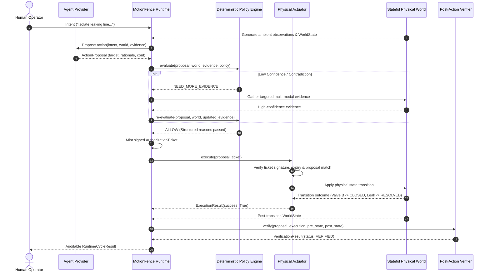

# MotionFence Architecture

## 1. System Overview

**MotionFence** is a deterministic runtime authorization layer for AI-generated physical actions.

In physical and industrial environments, deploying Large Language Models (LLMs) or autonomous reasoning agents introduces severe safety risks when models possess direct actuator authority. Models can hallucinate, suffer from perceptual ambiguity, misunderstand plant invariants, or act on ungrounded sensor data.

MotionFence establishes an architectural invariant:
> **An LLM must never have direct authority over an actuator.**
> The AI agent proposes what should happen; a deterministic MotionFence runtime independently decides whether the physical action is allowed, requires additional evidence, or must be denied.

---

## 2. Core Control Loop

```text
                 Human Intent
                      │
                      ▼
              Agent / Proposal
                      │
                      ▼
              Evidence Model
                      │
                      ▼
             Policy Evaluation
                      │
          ┌───────────┼───────────┐
          ▼           ▼           ▼
        DENY     NEED_EVIDENCE   ALLOW
                                      │
                                      ▼
                               Action Runtime
                                      │
                                      ▼
                              World / Actuator
                                      │
                                      ▼
                               Verification
                                      │
                                      ▼
                              Verified Outcome
```

The system executes a strictly ordered 6-phase cycle:

1. **Observe**: Ingest physical sensor readings (vision, pressure, thermal, acoustic, zone monitors) with explicit confidence scores and provenance.
2. **Propose**: The agent interprets intent and observations, formulating an [`ActionProposal`](file:///Users/urjasoft/Documents/MotionFence/motionfence/models/actions.py) with rationale and supporting evidence.
3. **Evaluate Policy**: The deterministic [`PolicyEngine`](file:///Users/urjasoft/Documents/MotionFence/motionfence/policy/engine.py) (containing **zero LLM code**) evaluates the proposal against declarative safety invariants, contradiction reports, and confidence bounds.
4. **Authorize / Deny / Request Evidence**:
   - `ALLOW`: Mints a cryptographically signed [`AuthorizationTicket`](file:///Users/urjasoft/Documents/MotionFence/motionfence/models/actions.py).
   - `DENY`: Rejects actuation with structured reasons.
   - `NEED_MORE_EVIDENCE`: Defers action and commands targeted multi-modal inspection.
5. **Act**: The [`PhysicalActuator`](file:///Users/urjasoft/Documents/MotionFence/motionfence/simulation/actuator.py) verifies the ticket signature and invariants before commanding hardware or stateful simulation.
6. **Verify**: The [`PostActionVerifier`](file:///Users/urjasoft/Documents/MotionFence/motionfence/runtime/verification.py) compares ground-truth post-state against declared postconditions, distinguishing commanded action from verified physical outcome.

---

## 3. Package & Module Boundaries

The repository is modularized into distinct, decoupled packages:

```text
motionfence/
├── agent/            # Agent proposal protocols & deterministic provider
│   └── provider.py   # ActionProposalProvider, LocalDeterministicProvider
├── config/           # Pydantic Settings & threshold configuration
│   └── settings.py
├── evidence/         # Evidence representations & contradiction detection
│   ├── models.py     # Evidence, EvidenceSource, ContradictionReport
│   └── contradiction.py # ContradictionDetector (multi-sensor conflict analysis)
├── models/           # Core domain models
│   ├── actions.py    # ActionProposal, AuthorizationTicket, ExecutionResult
│   ├── events.py     # RuntimeEvent, EventType
│   └── world.py      # WorldState, ValveState, CoolingState, LeakState
├── policy/           # Deterministic policy engine
│   ├── engine.py     # PolicyEngine.evaluate (NO LLM CALLS)
│   └── models.py     # Policy, PolicyDecision, PolicyReason, DecisionType
├── runtime/          # Central orchestration & post-action verification
│   ├── core.py       # MotionFenceRuntime orchestrator
│   ├── events.py     # EventBus & audit telemetry
│   ├── ticket.py     # TicketAuthority (HMAC-SHA256 signature generator)
│   └── verification.py # PostActionVerifier & VerificationResult
└── simulation/       # Stateful physical environment simulator
    ├── actuator.py   # PhysicalActuator (ticket-gated execution)
    ├── demo.py       # Interactive terminal demonstration
    ├── exceptions.py # UnauthorizedActionError, ActuatorFaultError
    └── world.py      # PhysicalWorld state machine
```

---

## 4. Sequence of Execution



---

## 5. Integration Status & Roadmap

| Subsystem | Phase 0 Status | Planned Phase 1+ Evolution |
| :--- | :--- | :--- |
| **Policy Engine** | `IMPLEMENTED` (Deterministic) | Additional domain rule packs, dynamic policy loading |
| **Evidence Contradiction** | `IMPLEMENTED` (Cross-sensor) | Temporal Bayesian uncertainty filtering |
| **Simulator** | `IMPLEMENTED` (Stateful miniature plant) | Continuous ODE fluid dynamics, physics engine adapter |
| **Authority Isolation** | `IMPLEMENTED` (Ticket-gated HMAC) | Hardware Security Module (HSM) / Ed25519 signing |
| **Post-Action Verifier** | `IMPLEMENTED` (State check) | Multi-modal perceptual re-verification |
| **Nebius / Nemotron** | `PLANNED` (Protocol ready) | NVIDIA Nemotron model on Nebius Token Factory |
| **Tavily Knowledge** | `PLANNED` (Protocol ready) | Retrieval of live plant SOPs and operating manuals |
| **Physical Hardware** | `PLANNED` (Hardware-free) | ROS 2 / Modbus / GPIO hardware adapter layer |
